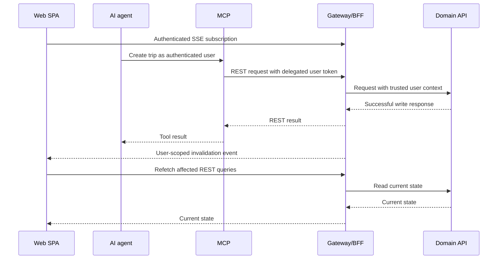

# Web PoC discovery

Status: product discovery approved; implementation has not started.
Date: 2026-09-28.

## Objective

Build a working Maletapp web client from the selected v3 concept. Users manage
their trips and packing lists through the gateway and authenticate with the
Keycloak instance deployed alongside it. Changes made by an authenticated AI
agent through MCP appear automatically in an open browser for the same user.

This document records the agreed direction and provides the handoff for an
implementation proposal. Implementation details explicitly listed as pending
must be resolved in that proposal rather than treated as approved contracts.

## Approved decisions

| Area | Decision |
| --- | --- |
| Rendering | Client-rendered SPA with React, TypeScript and Vite; static deployment, no SSR. |
| Visual reference | `web/app-design-concept-v3/maletapp-concepto.html`. |
| Composition | Atomic UI composition with reusable primitives and feature components; no separately packaged design system in this scope. |
| Language | English initially, with internationalization in place for future Spain Spanish (`es-ES`). |
| API access | Browser requests go through the gateway; the domain API remains private. |
| Authentication | Existing Keycloak, public web client, authorization code with S256 PKCE and tokens held in memory. |
| Live updates | Authenticated SSE owned by the gateway/BFF, with REST for reads and writes. |
| Event delivery | Best effort, one gateway instance, reconnection and state refetch for recovery. |
| Domain responsibility | Business data, rules and ownership; no knowledge of connected clients or browser subscriptions. |
| Product extensions | Add item categories and trip finish/reopen behavior to the domain contracts and implementation, and expose them through MCP. |
| Persistence | Keep the current in-memory domain store for this work. Durable storage is a future evolution and a prerequisite for VPS deployment, outside this scope. |

## Repository baseline

- `api/` is a .NET domain API with EF Core InMemory. Restarting it loses trips
  and items. Keycloak has its own persistent volume.
- The gateway is Hono/TypeScript. It validates Bearer tokens and forwards the
  validated GUID identity to the private domain using `X-Test-User-Id`.
- `/web/*`, `/mobile/*` and `/mcp/*` strip their prefix before proxying. Raw
  domain paths are also proxied. `gateway/src/bff/web.ts` currently contains a
  passthrough hook, not an implemented cookie session.
- The gateway has no application event stream or API CORS configuration yet.
- `maletapp-web` is already a public PKCE client with local callback
  `http://localhost:5173/callback`, origin `http://localhost:5173`, and API
  audience `api://maletapp`.
- MCP delegates the authenticated user's identity through token exchange and
  calls the gateway using raw paths such as `/trips` and `/items/{id}`.
- The v3 HTML is a standalone prototype with mocked/local-storage data and
  Spanish copy. Its storage model is not the domain contract.
- OpenSpec currently exists within `api/`; no root OpenSpec change was created
  during discovery.

Use source contracts and endpoint registrations to establish available behavior;
some README descriptions lag implemented deletion and packing operations.

## Proposed client structure

Use React Router for navigation, TanStack Query for remote state, `keycloak-js`
for authentication, i18next/react-i18next for translation, and CSS Modules with
the v3 CSS variables for styling. Generate TypeScript contract types from the
domain OpenAPI sources. Select and pin compatible package versions during the
implementation proposal; discovery did not choose exact versions.

The intended application location is `web/`, preserving prototype directories:

```text
web/src/
  app/                       Router, providers, application composition
  shared/
    ui/
      atoms/                 Button, Input, Badge, Icon
      molecules/             FormField, ConfirmDialog
    styles/                  Tokens and global styles
    api/                     HTTP transport and generated contract types
    auth/
    i18n/
    realtime/
  features/
    trips/
      components/            TripCard, TripGrid, CreateTripForm
      queries/
    packing/
      components/            ItemRow, PackingList, ItemForm
      queries/
  pages/                     TripsPage, TripDetailPage
```

Primitives accept properties and emit actions. Authentication, HTTP and query
behavior belong outside presentation primitives. Compose molecules, larger
feature components and pages without requiring an abstraction for every wrapper.
This allows later extraction into a design-system package. Consider accessible
headless primitives for dialogs and menus during implementation planning.

Preserve the concept's colors, typography, illustrations, responsive behavior
and interaction intent. Include loading, empty, error and disconnected states,
keyboard navigation, focus handling and reduced-motion support.

## Authentication and HTTP

1. Redirect the SPA to Keycloak for login and return to `/callback`.
2. Keep access and refresh tokens in memory through the adapter; do not persist
   them in localStorage or sessionStorage.
3. Send Bearer access tokens to `/web/*` on the gateway and coordinate renewal.
4. On logout or user change, cancel pending work, close the event stream and
   clear user-specific cached data.
5. Support normal login redirects when silent session checks are unavailable.

Use the Vite development proxy locally. Future static hosting and backend
origins can use `app.<domain>`, `api.<domain>` and `auth.<domain>`, with MCP exposed
separately. Add explicit allowed-origin CORS/preflight handling to the gateway
and exact callbacks/origins in Keycloak. The frontend build contains only public
configuration. Configure static hosting to serve SPA deep links and callbacks.

Cookie-backed BFF sessions are a possible future option, but are not the chosen
authentication model for this PoC. No browser-to-domain or browser-to-MCP data
path is required. The agent and browser must use the same Keycloak user to see
the same resources.

## Live update design



The gateway emits invalidation notifications after confirmed successful domain
writes, covering web, MCP and other supported aliases. The domain owns the
business result; the BFF owns connection management and delivery to clients.
The events are hints to refetch authoritative REST state, not a durable business
event log.

Start with coarse notifications such as `trips.changed` and `items.changed`.
Their final names, payloads, endpoint and versioning remain to be specified.
If an item deletion cannot identify the containing trip from its response,
invalidate the user's relevant item queries broadly rather than requiring an
extra lookup solely for notification enrichment.

Implementation requirements:

- Authenticate each stream and derive its user scope from validated identity;
  never accept a client-supplied user ID as subscription authorization.
- Use one connection per tab and support multiple tabs for the same user.
- Consume SSE with an authenticated fetch-based client: native EventSource
  does not provide a custom Authorization-header option.
- Define stream expiry and renewal; an established connection must not outlive
  its authorization indefinitely. Close it on logout.
- Reconnect with backoff and refetch on connection establishment/reconnection,
  including recovery of changes around the initial subscription.
- Refetch on focus/network recovery and use a moderate periodic reconciliation
  to cover lost notifications even while a connection appears healthy.
- Batch/debounce invalidations during bursts of agent writes, with bounded
  delay so continuous activity cannot indefinitely postpone refresh.
- Preserve open form drafts and handle resources deleted externally.
- Add heartbeats, cancellation cleanup and bounded handling of slow clients.
- Give the SSE endpoint its own streaming lifecycle rather than inheriting
  the ordinary domain proxy's 30-second request timeout. Configure ingress
  buffering, caching and timeouts appropriately when deployment is addressed.

A process restart, a committed write whose response is lost, or failure between
write confirmation and notification can lose an event. State refetch provides
eventual recovery. There is no durable replay or exactly-once guarantee.

This design assumes one gateway process and relevant writes going through it.
Multiple gateway instances or direct domain writers would require revisiting
event distribution, potentially with domain-originated events and a shared
transport. Such an evolution still leaves client connections with the BFF.

## Product scope and contract gaps

| Capability | Baseline and planned treatment |
| --- | --- |
| Trips | Existing create, list, read and delete operations are included. |
| Packing items | Existing create, list, read, edit, delete and explicit `isPacked` updates are included. |
| Notes and quantities | Use `notes` and `itemCount`; null means unspecified. Preserve PATCH omission versus explicit clearing. |
| Categories | Add persistent-in-domain category data and matching MCP support. Final representation and allowed values remain to be designed. |
| Finish/reopen | Add explicit trip lifecycle behavior and MCP support. Define its relationship with dates and preparation progress. |
| Card progress | Trips currently return no item counters. Initially fetch item lists with bounded concurrency for the small PoC dataset; consider aggregate summaries later if needed. |
| Illustrations/captions | Use local decorative variants and translated copy, without inventing backend fields or implying factual destination information. |
| Item suggestions | Start with a small local translated catalog; saving a suggestion creates a normal domain item. |

Categories and finish/reopen state must be shared domain data so the browser and
agent observe the same state. Browser storage must not become a separate source
of truth for these features. The prototype's `prepared` and `quantity` names map
to domain `isPacked` and `itemCount`; prefer contract names in application data.

## Internationalization

- English is the initial UI language and fallback; prepare for `es-ES` without
  requiring the Spanish translation or a language picker in this scope.
- Extract all UI copy, including validation, errors, accessibility labels,
  notifications, empty states and suggested-item labels.
- Use namespaces such as `common`, `trips`, `packing` and `auth`, with plural
  handling rather than sentence concatenation.
- Format dates and numbers with Intl. Preserve travel dates as date-only values
  without timezone-induced day shifts. Choose the initial English formatting
  locale during planning.
- Preserve user-authored destinations, names and notes in their original language.
- Configure the Keycloak login experience to use English initially.

## Concurrency: unresolved implementation requirement

`api/src/Trip.API/Infrastructure/Repositories/TripRepository.cs` currently loads
and rewrites a trip's baggage/item collection during updates. Concurrent agent
and browser writes can overwrite each other's changes. SSE does not solve this.

Before implementation, select and document an appropriate serialization or
optimistic concurrency strategy for the current in-memory, single-domain-instance
scope. It must cover relevant read-modify-write operations and deletion races.
Do not assume that serializing only browser calls protects against MCP writes.
Define how conflicts affect forms and retries; never blindly retry writes with
unknown outcomes. Durable persistence and broader concurrency support can evolve
later, but this known risk needs an explicit treatment in the proposal.

## Scope boundaries and future deployment

Included: working SPA, existing auth integration, gateway CORS and SSE, product
extensions across domain/MCP/web, internationalization foundations, and relevant
verification.

Outside this implementation scope:

- Durable database migration; required before eventual VPS deployment.
- Actual VPS/static-host deployment and production infrastructure provisioning.
- Multiple gateway replicas, message brokers, durable event replay or outbox.
- Offline editing, collaborative text editing, shared trips, and embedded AI chat.
- A published design-system library or a full Spanish translation.
- Authentication-provider migration or implementation of the previously planned
  external-identity mapping ADR.

The existing Compose configuration is for local development. Future deployment
must address HTTPS, public issuer/callback configuration, production Keycloak
configuration, ingress streaming and private domain access. Cloudflare Pages or
an equivalent static host remains a deployment option, not a required provider.

## Suggested delivery sequence

1. Produce an implementation proposal: settle category/lifecycle semantics,
   concurrency, SSE contract, error handling and test strategy.
2. Extend domain contracts, related specifications and implementation; update MCP
   tools so both clients can manage the approved product features.
3. Establish the SPA shell, tokens, UI primitives, routing, i18n and Keycloak flow.
4. Implement trip and packing screens against the gateway, including complete
   loading/error/empty states and accessible interactions from the v3 design.
5. Add gateway notifications and authenticated browser subscriptions with recovery.
6. Verify the complete browser/agent workflow, isolation, concurrency and visual
   behavior; update component documentation with actual implemented behavior.

This sequence is guidance, not a generated task list. A small vertical integration
slice can precede full screen composition to expose auth/streaming issues early.

## Acceptance criteria

- Login, callback, renewal and logout work with the existing Keycloak realm.
- All browser business requests use the gateway; domain ownership checks remain
  effective and authenticated state is cleared when switching users.
- The English SPA implements the approved v3 journeys and responsive appearance.
- Categories and finish/reopen behavior agree across contracts, API, MCP and UI.
- With the browser open, MCP trip creation and item changes for the same user
  become visible without manual reload; another user's data/events never appear.
- Multiple tabs, stream interruption, gateway restart and token expiry recover
  correctly, with eventual state reconciliation after missed notifications.
- Rapid agent changes do not cause unbounded refetches or erase form drafts.
- Concurrent writes satisfy the selected concurrency strategy without silent
  loss in the scenarios it claims to cover.
- Keyboard interaction, focus, validation, reduced motion and main viewport sizes
  are checked; critical flows have suitable automated integration/browser tests.
- Static output supports direct navigation to detail and callback routes.
- No durable-storage or VPS deployment work is implied by completion of this PoC.

## Documentation ownership and references

This root document owns discovery decisions across services. During
implementation, keep client architecture in `web/docs/architecture.md`, gateway
auth/SSE details in `gateway/docs/`, domain changes in its contracts and related
specifications, and MCP changes in its tool/auth documentation. Add component
development instructions where needed without duplicating conflicting contracts.

Repository references (relative to this document):

- [Selected design](../../web/app-design-concept-v3/maletapp-concepto.html)
- [Repository guidance](../../AGENTS.md)
- [Domain guidance](../../api/AGENTS.md)
- [Domain constitution](../../api/.context/constitution.md)
- [Trips contract](../../api/spec/trip.yml)
- [Items contract](../../api/spec/item.yml)
- [Repository implementation](../../api/src/Trip.API/Infrastructure/Repositories/TripRepository.cs)
- [Gateway architecture](../../gateway/docs/architecture.md)
- [Gateway routes](../../gateway/src/app.ts)
- [Gateway proxy](../../gateway/src/proxy.ts)
- [Web session hook](../../gateway/src/bff/web.ts)
- [Keycloak realm template](../../gateway/keycloak/maletapp-realm.json)
- [Compose stack](../../gateway/docker-compose.yml)
- [MCP overview](../../mcp/README.md)
- [MCP tools](../../mcp/src/mcp.ts)
- [MCP gateway calls](../../mcp/src/gateway.ts)

Technical references consulted during discovery:

- [React SPA tooling](https://react.dev/learn/build-a-react-app-from-scratch)
- [Vite static deployment](https://vite.dev/guide/static-deploy)
- [Keycloak JavaScript adapter](https://www.keycloak.org/securing-apps/javascript-adapter)
- [Hono streaming](https://hono.dev/docs/helpers/streaming)
- [TanStack Query invalidation](https://tanstack.com/query/latest/docs/framework/react/guides/query-invalidation)
- [EventSource constructor](https://developer.mozilla.org/en-US/docs/Web/API/EventSource/EventSource)
- [React i18next](https://react.i18next.com/)
- [Cloudflare Pages routing](https://developers.cloudflare.com/pages/configuration/serving-pages/)

## New-session handoff

Suggested prompt:

> Read `docs/discovery/web-poc.md` and the applicable repository instructions.
> Prepare the implementation proposal following the approved discovery decisions.
> Resolve the explicitly pending contract and concurrency details. Do not
> implement application code yet.

No application code, runtime configuration or infrastructure was changed as part
of this discovery. No implementation tests were run for this documentation task.
